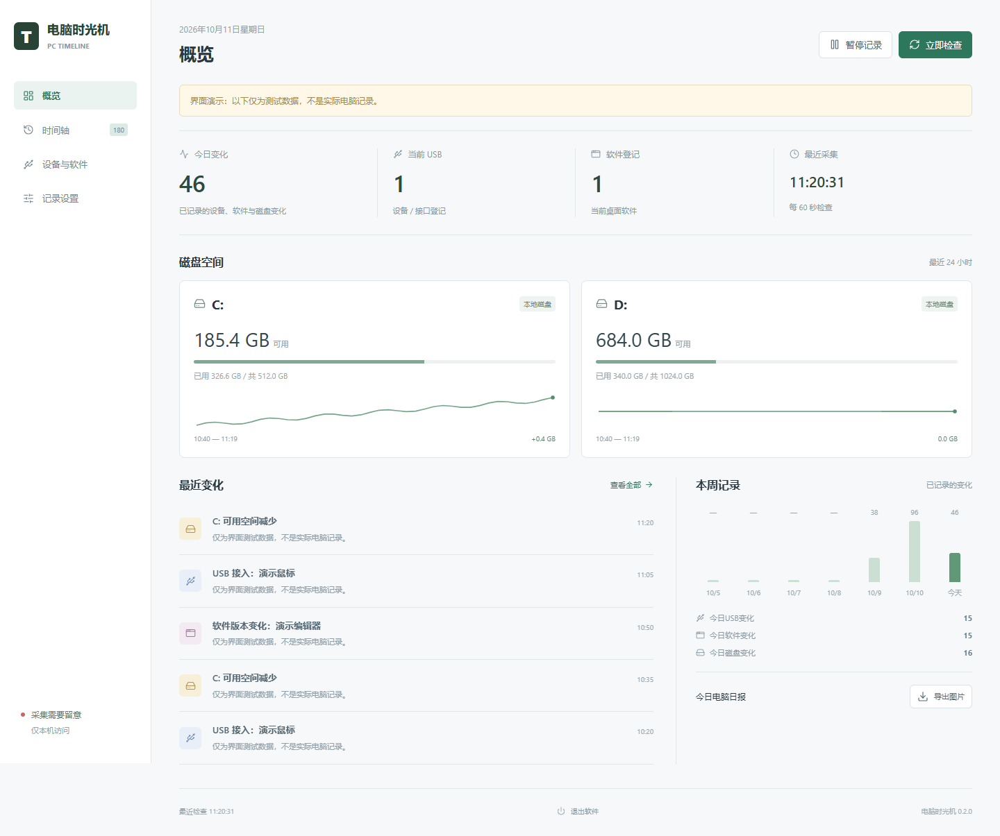

# 电脑时光机 · PC Timeline

**看看你的 Windows 电脑，今天发生了哪些变化。**

本地时间轴记录磁盘容量变化、USB 接入与移除、桌面软件登记变化。无需账号，不上传数据，不读取文件内容。

当前版本为 **v0.4.0 预览版**，包含设备/软件标签页、搜索高亮、紧凑时间轴和磁盘采样提示。详情见 [v0.4.0 更新记录](docs/UX-v0.4.0.md)。



## 下载并打开

到 [v0.4.0 下载页](https://github.com/Northfish0311/PC-Timeline/releases/tag/v0.4.0) 选择一个文件：

| 文件 | 适合谁 | 怎么使用 |
| --- | --- | --- |
| `PC-Timeline-Setup-0.4.0-x64.exe` | 推荐，大多数用户 | 双击安装，在桌面打开“电脑时光机” |
| `PC-Timeline-Portable-0.4.0-x64.exe` | 想先试用、不想安装 | 双击直接运行；启动时会临时解压，因此第一次可能稍慢 |
| `SHA256SUMS.txt` | 想校验下载文件 | 包含两个 EXE 的 SHA-256 校验值，不是启动文件 |
| GitHub 自动生成的 Source code ZIP/TAR | 开发者 | 只是源码，不是安装程序 |

适用于 Windows 10/11 x64。**EXE 已带运行环境，不用安装 Node.js、不需要命令窗口，也不需要管理员权限。** 双击后直接显示软件窗口；不会要求你手动输入网页地址。端口会自动分配，避免与其他程序冲突。

当前仍是预览版。安装包尚未购买代码签名证书，Edge 或 Windows SmartScreen 可能提示下载不常见、发布者未知。只从上述 Releases 下载；遇到提示时先核对来源和校验值，不要关闭系统安全保护。单位管理的电脑可能不允许运行未签名软件。

```powershell
Get-FileHash .\PC-Timeline-Setup-0.4.0-x64.exe -Algorithm SHA256
```

将结果与同版本 `SHA256SUMS.txt` 对照。

## 可以做什么

- **概览**：今天的事件数量、磁盘剩余容量、最近发生的变化。
- **时间轴**：按磁盘、USB、软件筛选已记录的变化，分类显示匹配数量；列表上方图标切换舒适或紧凑布局。
- **搜索与日期**：选择今天、最近 7 天或指定日期，结合多个关键词筛选并高亮匹配文字；长列表按需显示更多。指定日期和相对范围不叠加，避免互相冲突。
- **变化详情**：点击事件查看采集时间和变化前后的状态、版本或容量；旧记录没有数值的会明确说明。上一条/下一条按钮和方向键可连续浏览，Escape 关闭。
- **磁盘趋势**：展示最近 24 小时内已保存的实际采样；鼠标停留或键盘聚焦曲线可查看采样时间与容量，小变化以 MiB/KiB 显示；一周统计点击某天可跳到对应记录。
- **记录设置**：检查间隔可选 30 秒至 5 分钟，容量变化阈值可选 64 MiB 至 2 GiB。只有实际更改后才开放保存，撤销按钮恢复到已保存值。
- **设备与软件**：在独立标签页查看 USB 接口和软件登记，分别搜索名称、类别或版本，各自保留搜索词。概览数字可直接进入对应列表。
- **暂停记录**：停止自动采集，保留历史；手动刷新仍然可用。
- **导出图片**：保存 PNG 日报，只包含日期、变化数量和磁盘容量，不包含设备名称、软件名称和私人路径。

打开软件后首次采集建立基准，默认每分钟采集一次，可在“记录设置”调整。暂停不取消已经开始的单次采集。关闭软件窗口或点击底部“退出软件”即可退出；电脑关机、软件退出后不再记录。没有默认开机启动，也不常驻托盘。

阅读时间轴时，新记录会先提示，不会直接插到正在读的位置；点击更新提示才载入。切页保留各页的阅读位置。连接失败保留旧数据，点击“重新连接”可重试；设置保存失败不会丢掉未保存的选择。

## 请先了解这些限制

- 只能记录开始运行之后的变化，不恢复以前的历史。
- 两次采集之间插入又拔出的设备可能漏记。
- USB 复合设备包含多个接口，列表数量不等于物理设备数量。
- 软件列表来自 Windows 卸载注册表，不包括所有便携应用或商店应用；“登记移除”不等于确认全部文件已卸载。
- 相邻两次采集间的磁盘差值默认达到 256 MiB 才记录，可在设置中调整。暂不定位具体文件，也不做全盘目录扫描。
- 采集失败保留旧数据，不把失败当作设备全部移除。某一类采集失败时跳过这一类比较。
- 暂不记录 CPU、崩溃和重启，不进行因果诊断，也不自动修复电脑。

## 隐私、存储与清除

只绑定电脑自己的 `127.0.0.1`，不开放局域网访问，不含遥测，不上传数据。

不读取文档、聊天、浏览记录或密码；不录屏、不记录键盘、不自动删除文件。系统登记里的软件和设备名称可能包含个人信息，因此历史记录也属于私人数据。USB 实例标识只保存为 SHA-256 散列，不保存原始序列号。

**安装版和便携版**的历史位于：

```text
%APPDATA%\PC Timeline\data\timeline.json
```

两种 EXE 使用同一份当前用户历史。最多保留 2,000 条事件和 1,440 个磁盘采样点；达到上限后移除最早记录。趋势不会补写关机、暂停或失败期间的数据。程序升级不会主动删除历史，旧版记录会自动迁移，但无法补出以前未保存的趋势或对比数值。清除时先退出程序，再在文件资源管理器输入 `%APPDATA%\PC Timeline`，删除其中的 `data` 文件夹。卸载软件不保证清除这份历史。

**源码方式运行**的数据位于项目自己的 `data` 目录。该目录已加入 `.gitignore`。不要上传 AppData、data 目录或带实际电脑信息的截图。本 README 截图仅使用明确标注的演示数据。

## 开发者运行

普通用户直接下载 EXE 即可。只有运行源码才需要安装 [Node.js LTS](https://nodejs.org/)（20 或以上）。

```powershell
npm ci
npm test
npm run check
npm run desktop
```

想在浏览器运行源码，可以双击 `Start.cmd` 或运行 `npm start`。保持启动窗口打开，在本机浏览器访问显示的地址，默认 `http://127.0.0.1:8790`。如果端口被占用，在 PowerShell 运行 `$env:PORT=8791; npm start`，使用输出的新地址。

本地打包 Windows EXE：

```powershell
npm run build
```

产物在 `dist` 目录。GitHub 的 **Windows checks and build** 工作流执行语法检查、自动化测试和打包；工作流附件是测试构建，正式下载见 Releases。

## 后续方向

用户选定目录的容量对比、可选开机启动、更细的时间范围筛选。尚未实现的功能不会当作已完成宣传。

MIT 开源协议。安全说明见 [SECURITY.md](SECURITY.md)。
