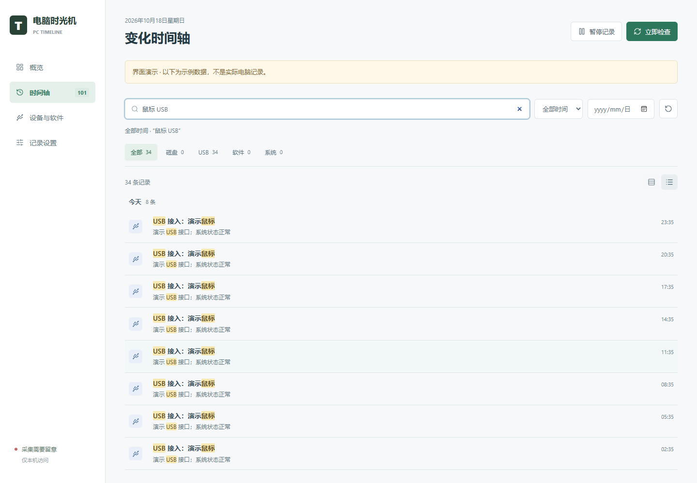

# v0.4.0 界面与交互改进

本页功能包含在 v0.4.0 安装版与便携版中。升级时先退出旧软件，再安装或打开新版；原有历史记录保留。

## 时间轴与搜索

- 时间轴支持多个关键词组合搜索，名称和描述可以分别匹配；关键词会在结果中高亮。设备名称、类别和软件版本的搜索结果同样高亮。
- 分类按钮显示当前日期与搜索条件下，各类型各有多少条记录。选择某个类型不会把其他类型的数量一起清零。
- 列表上方的两个图标切换“舒适列表”和“紧凑列表”；鼠标停留可看到名称。选择在本次打开期间保留。
- 搜索与分类栏在滚动时保持可见。离开时间轴再返回，保留当前结果、展开数量和阅读位置；期间新增的记录仍由更新提示载入。
- 概览的最近变化补充“今天”“昨天”或日期；详情的磁盘对比补充精确净变化。切换上一条/下一条详情时，回到详情顶部。

## 设备与软件

- “USB 设备”和“软件”分为两个标签页，分别显示总登记数，不再需要滚过整页 USB 列表才能找软件。
- USB 可按名称、类别、原始系统状态搜索；软件可按名称和版本搜索。多个搜索词需要同时匹配。
- 每个标签页保留各自的搜索词。搜索无结果时，可点击“清除搜索”恢复列表。
- 两类长列表都支持按需显示更多。再次点击当前标签不会折叠已经展开的结果。
- 名称与版本分别排列，长名称会换行。USB 数量仍表示系统接口登记，不等于物理设备数量。

## 概览与趋势

- 点击“今日变化”进入今天的时间轴；点击 USB 或软件登记数字进入对应列表。
- 磁盘曲线可用鼠标或键盘查看实际采样的时间与剩余空间。聚焦曲线后，左右方向键逐点移动，Home/End 跳到首末采样。
- 小幅变化使用 MiB、KiB 或 B 显示，避免变成“0.0 GB”；首末数值相同时显示“无净变化”。这不代表期间没有波动。
- 趋势仍只使用已经保存的真实采样，不补写空缺时间，不把曲线变化归因到某个文件或软件。

## 状态与布局

- 本地服务断线时，切换页面仍显示“连接中断”和旧数据提示，不再恢复为正常记录状态。
- 设备状态、类别颜色、标题与正文间距统一；详情底部操作区和窄窗口布局调整。
- 保留上一版的筛选、连续查看详情、设置撤销、新记录提示和切页滚动位置。

## 验证

- 28 项 Node 自动化测试通过，覆盖采集比较、请求边界、多词搜索、字面量高亮、时间戳选点与容量变化格式。
- 浏览器回归验证了标签切换、独立搜索词、分页、键盘操作、采样提示、概览入口、断线切页和部分采集失败。
- 截图与溢出检查覆盖 1440、1024、880、760、390、320 像素宽度的四个页面；补测超长名称、版本和详情。
- 补充验证了两种列表密度、分类数量、搜索高亮、跨页面保留时间轴，以及类似 HTML 的设备名称不会被当作页面代码执行。
- 测试只使用演示数据，不发布实际电脑的设备、软件名称或历史记录。

本轮没有修改采集器、保存路径、历史数据格式或网络访问范围。
